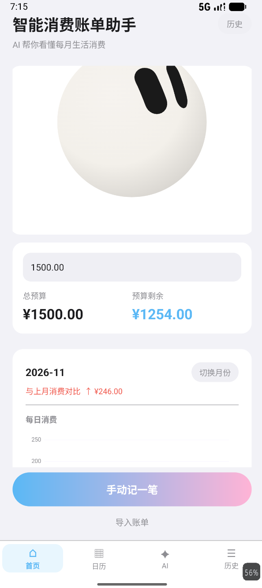
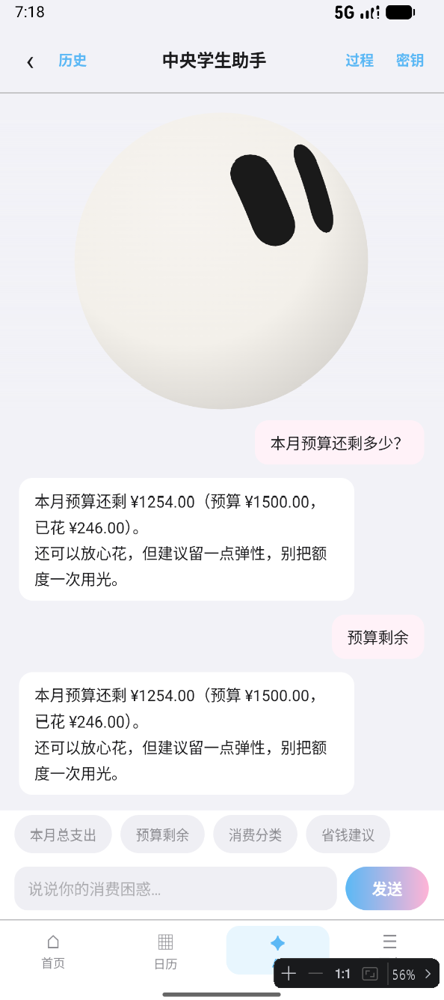
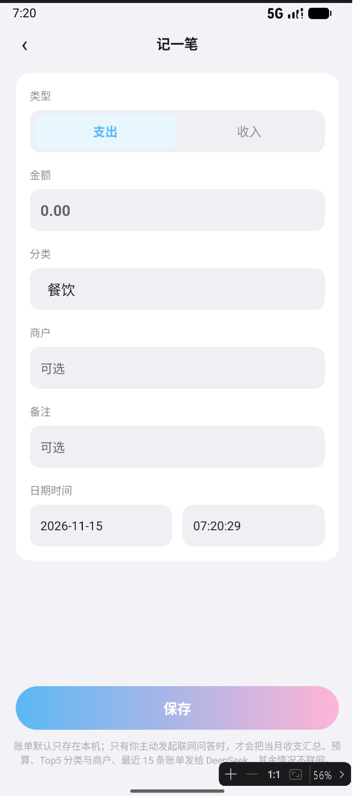
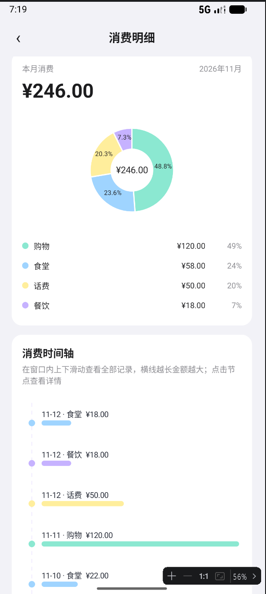
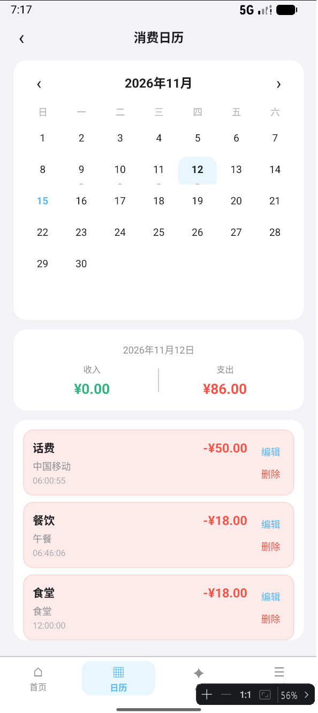
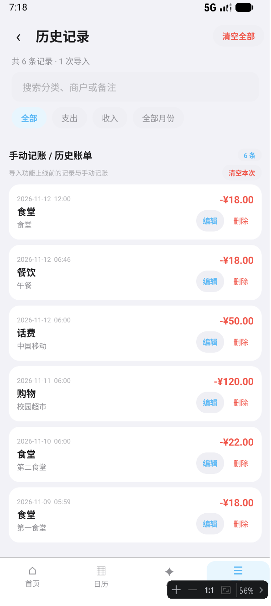

# 学生消费账单（中央学生助手）

一款面向学生场景的 Android 记账应用，提供手动记账、账单导入、预算与图表分析，以及接入 DeepSeek 的中央学生助手。普通账本功能在本机运行；联网助手支持流式对话、账单查询、确认后记账和过程留痕。

快速搭建与验证请直接查看 [10 分钟极速复现指南](#10-分钟极速复现指南)。

## 项目概览

| 项目 | 当前配置 |
|---|---|
| 应用名称 | 学生消费账单 |
| 包名 | `com.campusbill.app` |
| 版本 | `versionCode 3` / `versionName 2.1` |
| 开发语言 | 纯 Java，源码与目标兼容性均为 Java 17，无 Kotlin 代码 |
| UI | XML 布局 + ViewBinding；10 个 Activity 均锁定竖屏 |
| 本地数据 | Room 数据库 `student_bill.db`，保存账单、导入批次、会话、消息与会话记忆 |
| 图表 | MPAndroidChart + 自定义时间轴和柱状图渲染器 |
| 网络 | `HttpURLConnection` 连接 DeepSeek，SSE 流式读取回复 |
| 系统要求 | Android 10（API 29）及以上；`compileSdk 37`、`targetSdk 36` |

## 功能一览

| 模块 | 功能 |
|---|---|
| 手动记账 | 支出/收入切换，分类联动，记录金额、商户、备注和日期时间 |
| 账单管理 | 消费日历按日查看；账单编辑与删除；历史记录支持关键词、收支类型和月份筛选，导入批次可展开/收起查看明细，并可按批次或全部清空 |
| 预算管理 | 当月预算持久化，显示剩余金额；超支时切换为红色警示样式 |
| 图表分析 | 每日支出折线图、分类支出柱状图、分类饼图、收支时间轴和商户消费排行 |
| 月份联动 | 首页只列出已有账单的月份；选中的月份会持久化，并传递给明细、日历、排行及助手查询 |
| 账单导入 | 支持粘贴文本、CSV、PDF、XLSX，适配常见微信/支付宝账单字段；导入结果按批次保存和管理，重复导入的同一笔账单会自动跳过 |
| 中央学生助手 | 本地快捷问答、DeepSeek 流式对话、四类工具调用、确认后写入、状态展示和本机过程记录 |
| 情绪球交互 | 首页和对话页展示 Emotion Ball，支持触摸视线跟随、手机姿态驱动和助手状态表情 |
| 历史会话 | 会话与消息保存在 Room，支持新建、切换、重命名和删除；显示上下文占用，并支持记忆交接 |

## 界面预览

以下截图使用演示数据，展示当前版本的主要页面。

| 首页与预算 | 中央学生助手 | 手动记一笔 |
|---|---|---|
|  |  |  |

| 消费明细 | 消费日历 | 历史记录 |
|---|---|---|
|  |  |  |

## 中央学生助手

### 离线与联网行为

- 「本月总支出」「预算剩余」「消费分类」「省钱建议」四个快捷问题由本地规则和 Room 数据作答，无需 API Key。
- 帮助、商户排行等未被中央助手规划接管的本地意图可离线处理；未匹配且未配置 Key 的普通文本显示本地兜底提示。
- 查账、AI 记账、运势和日记上下文等中央助手链路需要已测通的 DeepSeek Key；未配置时显示 `API_KEY` 错误，不伪造工具调用或账单结果。
- 联网回复采用流式输出，文字状态分为「思考 / 调用工具 / 等待确认 / 出错」。
- 语音输入已取消，当前输入方式为文字，不包含麦克风、系统语音识别或 Vosk 功能。

### 工具与写入约束

| 工具 | 作用 |
|---|---|
| `query_spend` | 只读查询本机账本，支持今天、本周、首页选中月份、自定义区间和全部历史，并可按商户或分类筛选 |
| `propose_add_bill` | 生成待确认账单；只有用户在确认卡中同意后才写入 Room，并回读核对 |
| `request_diary_context` | 申请引用应用私有目录中的日记文本；确认前不会把正文加入对话 |
| `daily_fortune` | 生成今日运势、情绪晴雨表或轻量塔罗文案 |

涉及账单的回复会先查询真实账本；查询成功前，应用会拦截包含金额或笔数的模型回复。`query_spend` 的合计和分类汇总覆盖全部匹配记录，随请求发送的明细最多 20 条。

对话页提供「过程」入口，可查看本机 JSONL 中的 Prompt 版本与摘要、工具参数、状态、思考摘要、确认记录和写入回读结果。

### DeepSeek 配置

首次进入对话页且尚未配置密钥时，会打开 DeepSeek 密钥向导；也可点击右上角「API KEY」重新打开。

1. 粘贴自己的 DeepSeek API Key。
2. 点击「测通并保存」。应用会发送一次最小请求验证密钥，成功后保存。
3. 开始联网问答；需要时可在向导中清除密钥。

当前向导只连接 DeepSeek，默认配置为：

```text
Base URL: https://api.deepseek.com/chat/completions
Model:    deepseek-chat
```

密钥不是 Gradle 属性或编译期环境变量，也不需要写入仓库。API Key 使用 Android Keystore 中的 AES/GCM 密钥加密，SharedPreferences 只保存密文和 IV。

## 权限与隐私

1. Manifest 仅申请 `android.permission.INTERNET`，用于密钥测通和联网助手；普通记账、导入、日历和图表功能不发起网络请求。
2. 剪贴板仅在用户点击「粘贴导入」时读取一次，无后台监听或启动时读取。
3. CSV、PDF、XLSX 均通过 SAF 系统文件选择器读取，不申请存储权限，不使用爬虫、无障碍服务或自动拉取微信/支付宝账单。
4. 账单、导入批次、会话和记忆默认保存在本机 Room；`allowBackup=false`，不提供云同步，卸载应用会删除这些本机数据。
5. 联网助手会向 DeepSeek 发送系统提示词、当前对话内容和生成回复所需的上下文。工具被调用后，相应结果也会进入后续请求，可能包括账单汇总、最多 20 条匹配明细、确认后的账目字段或经用户确认的日记文本；会话记忆提炼同样会发送当前对话文本。
6. 过程日志保存在应用私有目录 `assistant/process/runtime/`，写入前会脱敏密钥，但仍可能包含账单字段或对话相关内容，不会自动同步到仓库。

## 10 分钟极速复现指南

目标：在已安装 Android Studio、SDK，并已有可用模拟器或真机的前提下，从克隆仓库到安装运行、完成离线与联网主线验证。首次安装 Android Studio、下载 SDK 或创建模拟器不计入该目标；完整真机验收见 [复现与演示文档](docs/assistant/REPRODUCE.md)。

### 1. 环境配置

| 项目 | 要求 |
|---|---|
| 操作系统 | Windows、macOS 或 Linux，以下命令分别给出 PowerShell 与 Bash 示例 |
| Android Studio | Narwhal 或更新版本，使用与 AGP 9.4.0 兼容的内置 JBR |
| Java | 源码和目标兼容性为 Java 17；命令行构建时让 `JAVA_HOME` 指向兼容 JDK/JBR |
| Android SDK | Platform API 37、对应 Build-Tools、Platform-Tools；模拟器还需安装 Android Emulator |
| Gradle | 使用仓库 Wrapper，版本 9.6.0，无需单独安装 |
| 运行设备 | Android 10（API 29）及以上的模拟器或真机，真机需开启开发者选项与 USB 调试 |
| 网络 | 首次 Gradle Sync 需下载依赖；普通账本功能可离线使用，联网助手需可访问 DeepSeek |

在 Android Studio 的 **SDK Manager** 中确认：

- **SDK Platforms**：安装 Android API 37。
- **SDK Tools**：安装 Android SDK Build-Tools、Android SDK Platform-Tools；使用模拟器时安装 Android Emulator。
- 打开 **Device Manager** 创建 API 29+ 设备，或连接已启用调试的真机。

### 2. 获取源码

```bash
git clone https://github.com/MIMIMIXIAOBAI/Student-Spending-Bill.git
cd Student-Spending-Bill
```

也可以直接用 Android Studio 打开已有仓库根目录，等待 Gradle Sync 后点击 **Run**，无需执行下面的命令行步骤。

### 3. 本机配置与环境变量模板

#### 方式 A：配置 `local.properties`（推荐）

在仓库根目录新建 `local.properties`，按实际 SDK 路径选择一行填写：

```properties
# Windows
sdk.dir=C:\\Users\\<你的用户名>\\AppData\\Local\\Android\\Sdk

# macOS
# sdk.dir=/Users/<你的用户名>/Library/Android/sdk

# Linux
# sdk.dir=/home/<你的用户名>/Android/Sdk
```

该文件已被 `.gitignore` 排除，不要提交本机路径。

#### 方式 B：使用临时环境变量

也可不创建 `local.properties`，在当前终端设置 SDK 环境变量。以下配置只对当前终端生效。

Windows PowerShell：

```powershell
$env:JAVA_HOME = "C:\Program Files\Android\Android Studio\jbr"
$env:ANDROID_HOME = "$env:LOCALAPPDATA\Android\Sdk"
$env:ANDROID_SDK_ROOT = $env:ANDROID_HOME
$env:Path = "$env:JAVA_HOME\bin;$env:ANDROID_HOME\platform-tools;$env:Path"
```

macOS / Linux Bash：

```bash
# macOS 示例
export JAVA_HOME="/Applications/Android Studio.app/Contents/jbr/Contents/Home"
export ANDROID_HOME="$HOME/Library/Android/sdk"

# Linux 可改用以下路径
# export JAVA_HOME="$HOME/android-studio/jbr"
# export ANDROID_HOME="$HOME/Android/Sdk"

export ANDROID_SDK_ROOT="$ANDROID_HOME"
export PATH="$JAVA_HOME/bin:$ANDROID_HOME/platform-tools:$PATH"
```

`local.properties` 与 `ANDROID_HOME` 选择一种 SDK 配置方式即可，`JAVA_HOME` 仍应指向兼容 JDK/JBR。可另行参考 [env.example](docs/assistant/env.example)。

**DeepSeek 配置不属于构建环境变量。** 项目不会从 `DEEPSEEK_API_KEY`、`gradle.properties` 或 `local.properties` 读取密钥，也无需创建密钥文件。构建和离线功能不需要 Key；联网验证时，在应用内「DeepSeek 密钥向导」粘贴并测通，由 Android Keystore 加密保存。不要把真实 Key 写入仓库、终端模板或提交记录。

### 4. 依赖清单

构建工具和 Android 配置：

| 组件 | 版本 / 配置 |
|---|---|
| Android Gradle Plugin | 9.4.0 |
| Gradle Wrapper | 9.6.0 |
| Java Source / Target Compatibility | 17 |
| `compileSdk` / `targetSdk` / `minSdk` | 37 / 36 / 29 |
| AndroidX ViewBinding | 已启用 |

应用与测试依赖以 `app/build.gradle` 为准：

| 依赖 | 版本 | 用途 |
|---|---|---|
| AndroidX AppCompat | 1.7.1 | 基础兼容组件 |
| AndroidX ConstraintLayout | 2.2.1 | 布局 |
| AndroidX RecyclerView | 1.3.2 | 账单、会话和排行列表 |
| AndroidX Room Runtime / Compiler | 2.6.1 | 本地数据库与注解处理 |
| OpenCSV | 5.9 | CSV 解析，支持 UTF-8 / GBK 检测 |
| PDFBox Android (`com.tom-roush`) | 2.0.27.0 | PDF 文本提取 |
| MPAndroidChart | v3.1.0 | 折线图、柱状图和饼图 |
| JUnit | 4.13.2 | 单元测试 |
| `org.json:json` | 20240303 | JVM 测试中的 JSON 支持 |

所有依赖均由 Gradle 从 `google()`、`mavenCentral()` 和 JitPack 自动下载，不需要手动放置 JAR/AAR。XLSX 由项目内的 ZIP + XML 解析器处理，不依赖 Apache POI；项目也不需要 Node.js、npm、Python、Vosk 模型或独立后端服务。

### 5. 构建、安装与测试

先确认设备已被识别：

```bash
adb devices
```

Windows PowerShell：

```powershell
.\gradlew.bat --version
.\gradlew.bat assembleDebug
.\gradlew.bat installDebug
.\gradlew.bat testDebugUnitTest
```

macOS / Linux：

```bash
./gradlew --version
./gradlew assembleDebug
./gradlew installDebug
./gradlew testDebugUnitTest
```

预期结果：

- Gradle Wrapper 自动准备 Gradle 9.6.0，并完成助手协议文件同步。
- APK 输出到 `app/build/outputs/apk/debug/app-debug.apk`。
- `installDebug` 在已连接设备上安装并显示「学生消费账单」。
- `testDebugUnitTest` 执行本地 JVM 单元测试，报告位于 `app/build/reports/tests/testDebugUnitTest/`。

### 6. 启动验证

1. **离线账本**：无需 Key，点击「记一笔」新增一条今日午餐账单，返回首页确认账单、预算和图表更新。
2. **离线助手**：进入对话页，依次点击「本月总支出」「预算剩余」「消费分类」「省钱建议」，确认无网络也能基于本机账本回答。
3. **联网助手（可选）**：在「API KEY」向导中测通自己的 DeepSeek Key，询问「这周食堂花了多少？」，确认出现工具调用状态和真实查账回复。
4. **确认后写入**：输入「再记一笔今天午餐 18 元」，检查确认卡；只有点击确认后才写入，打开「过程」核对工具参数与回读结果。

## 使用说明

1. **录入账单**：点击「记一笔」手动录入，或进入「导入账单」选择粘贴、CSV、PDF/XLSX 导入。
2. **设置预算**：在首页预算输入框填写金额，剩余与超支状态会随账单变化自动更新。
3. **查看分析**：在首页切换月份并查看折线图、柱状图；进入收支明细、商户排行或消费日历查看更多数据。
4. **管理历史**：在「历史」页搜索、筛选、编辑或删除账单，也可清除某个导入批次。
5. **使用助手**：轻点首页情绪球进入对话。四个快捷问题可离线使用；联网工具链先完成 DeepSeek 密钥测通。
6. **确认 AI 记账**：检查确认卡中的金额、分类和日期，确认后才写入；点击「过程」核对工具参数与回读结果。

## 项目结构

```text
app/
├── build.gradle                         # Android 配置、依赖与助手文档同步任务
└── src/
    ├── main/
    │   ├── AndroidManifest.xml          # 权限、Application 与 10 个 Activity
    │   ├── assets/
    │   │   ├── assistant/               # Prompt、工具 schema、意图与情绪协议
    │   │   └── emotion-ball/            # 本地 Emotion Ball WebView 资源与许可
    │   ├── java/com/campusbill/app/
    │   │   ├── MainActivity.java        # 首页、预算、图表、月份与情绪球
    │   │   ├── *Activity.java           # 记账、编辑、日历、历史、导入、明细、排行、对话与过程页
    │   │   ├── data/                    # Room 实体、DAO、数据库与账本访问
    │   │   ├── imports/                 # 粘贴、CSV、PDF、XLSX 解析
    │   │   ├── chart/                   # 图表渲染与自定义时间轴
    │   │   ├── chat/ai/                 # 本地意图、DeepSeek 配置与流式客户端
    │   │   ├── chat/ai/assistant/       # 助手控制、工具、确认、日记与过程日志
    │   │   ├── chat/session/            # 会话持久化、上下文用量与记忆交接
    │   │   └── ui/                      # 情绪球视线、布局和底部导航辅助
    │   └── res/                         # XML 布局、样式、图标与文案
    └── test/                            # JVM 单元测试
docs/
├── assistant/                           # 复现指南、演示、技术文档、协议与第三方许可
└── PROJECT-INVENTORY.md                 # 项目全量识别报告
App截图/                                 # 当前版本主要页面截图（演示数据）
prompt_evolution.md                      # Prompt 与需求演进记录
Promat历史/                              # 按工具分类的历史对话、Prompt、决策与协议归档
```

构建前，`syncAssistantDocs` 会把 `docs/assistant` 中的五份协议文件同步到 `app/src/main/assets/assistant`。

## 测试

当前测试源码包含 **8 个测试类、51 个 `@Test`**，覆盖本地回复、助手核心规则、预算状态、会话规则、姿态视线计算、情绪球尺寸与淡出、输入区布局等。

```powershell
.\gradlew.bat testDebugUnitTest
```

完整复现、真机检查和演示流程见 [10 分钟极速复现指南](docs/assistant/REPRODUCE.md)。

## 相关文档

- [项目全量识别报告](docs/PROJECT-INVENTORY.md)
- [中央学生助手复现指南](docs/assistant/REPRODUCE.md)
- [演示脚本](docs/assistant/DEMO-SCRIPT.md)
- [技术文档（Markdown）](docs/assistant/TECHNICAL-DOC.md) / [技术文档（PDF）](docs/assistant/TECHNICAL-DOC.pdf)
- [交赛材料清单](docs/assistant/SUBMISSION-CHECKLIST.md)
- [助手 Prompt 与协议说明](docs/assistant/README.md)
- [第三方许可与来源](docs/assistant/THIRD_PARTY.md)

## 第三方说明

Emotion Ball 来源于开源项目 [sam70361/aora-bot](https://github.com/sam70361/aora-bot) 的 `emotion-ball` 分支，当前 vendored 资源对应 commit `f793bb445ebad66a1a19bae75b4c27b306d2f95e`，位于 `app/src/main/assets/emotion-ball/`。

**该球形角色的造型、配色与特效仅用于学习和本比赛演示，不包含商业授权，也不提供商业授权。** 如需商用，必须移除该视觉或更换为自有/已获授权的形象。详细许可和其余依赖说明见 [THIRD_PARTY.md](docs/assistant/THIRD_PARTY.md)。
