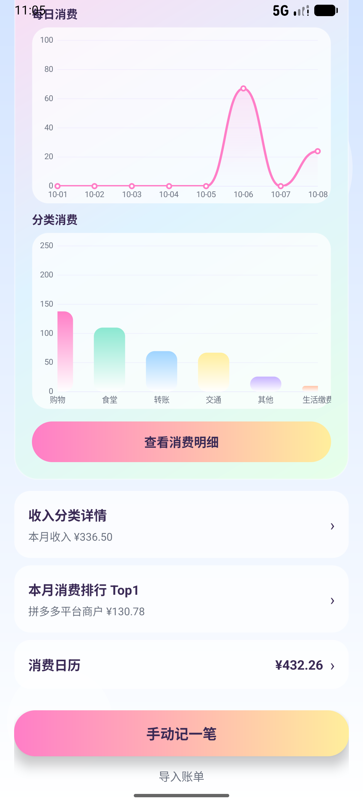
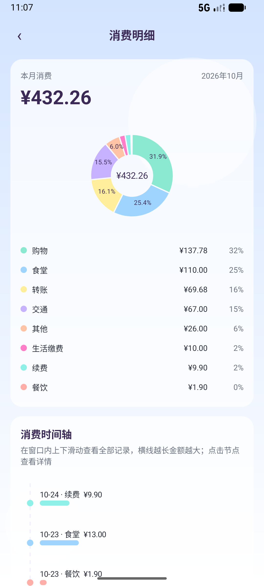
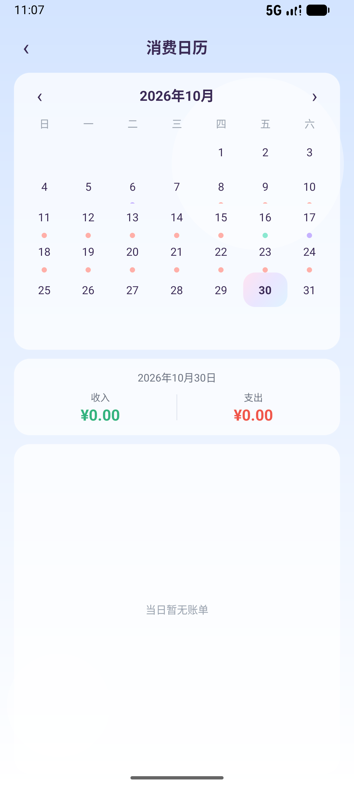
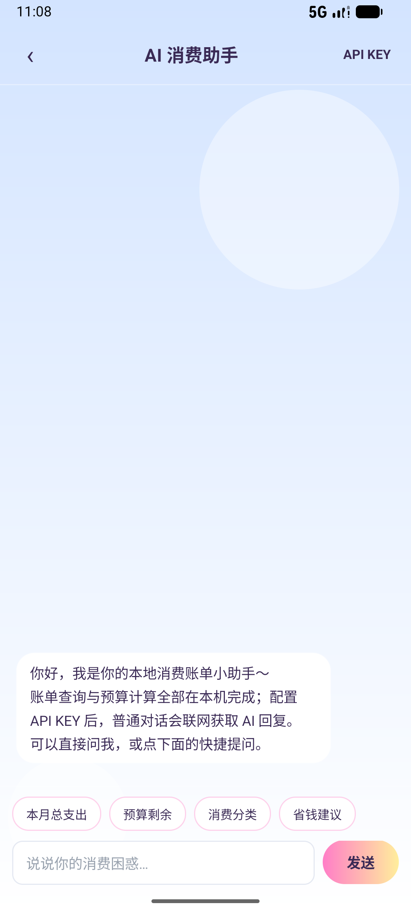

# 学生消费账单 APP（智能消费账单）

一款面向学生群体的 Android 本地记账应用：手动记账、多方式导入、图表化消费分析、预算管理与 AI 消费建议。账单默认只存在本机 Room；只有用户主动发起联网问答时，才会把当月收支汇总、预算、Top5 分类与商户、最近 15 条账单发给 DeepSeek（旧版 AI 页由 `BillContextBuilder` 组装）；其余情况不联网、不上传。`allowBackup=false`，卸载或换机即丢账本。

- 包名：`com.campusbill.app`
- 开发语言：**纯 Java**（无任何 Kotlin 代码）
- UI 实现：XML 布局 + ViewBinding，竖屏手机适配；视觉为「苹果式骨架 × Y2K 材质点缀」（校园蓝主 CTA #2F6FED，粉/薄荷/柠檬仅作点缀；全 App 统一近纸页底，内容卡近白奶油，玻璃仅用于顶栏/浮层）
- 进度：P0–P3 视觉刷新已合入分支 feat/ui-tokens-p0（Token/页底、主页+图表、表单/日历/导入、AI 对话/History）
- 最低系统：Android 10（API 29），targetSdk 36

## 功能一览

| 模块 | 功能 |
|---|---|
| 手动记账 | 支出/收入切换、分类下拉（随类型切换）、金额/商户/备注、系统日期时间选择器 |
| 账单管理 | 消费日历按日查看、编辑（自动填充原账单）、删除（二次确认）、历史记录页（支持删除导入批次） |
| 预算管理 | 当月预算设置持久化；预算剩余 ≥0 蓝白渐变，超支切换红白渐变并显示「超出」 |
| 图表分析 | 每日消费折线图、分类消费柱状图（均可横向滑动）、分类占比饼图、消费时间轴（横线长度映射金额，点击节点看详情） |
| 月份切换 | 顶部弹窗仅列出数据库已有账单月份，切换后全页面数据联动刷新 |
| 商户排行 | 当月商户消费金额降序，前三名放大突出 |
| AI 消费助手 | 本地规则引擎离线回答账单类问题（总支出/预算剩余/分类构成/省钱建议）；可选在应用内配置 API KEY，普通对话联网请求 OpenAI 兼容接口；只有用户主动发起联网问答时，才会把当月收支汇总、预算、Top5 分类与商户、最近 15 条账单发给 DeepSeek，其余情况不联网 |
| 账单导入 | 粘贴导入（仅点击时读取一次剪贴板）、CSV 导入（OpenCSV）、PDF/XLSX 导入（SAF + PDFBox），自动识别支付宝/微信账单格式，导入结果按批次管理 |

## 合规与隐私设计

1. 剪贴板仅在用户点击「粘贴导入」按钮时读取一次，无后台监听、无启动读取
2. 文件导入全部通过 SAF 系统文件选择器，**不申请** `MANAGE_EXTERNAL_STORAGE` 及任何存储权限
3. 无爬虫、无障碍抓取、自动拉取微信/支付宝账单的任何逻辑
4. 账单默认只存在本机 Room；只有用户主动发起联网问答时，才会把当月收支汇总、预算、Top5 分类与商户、最近 15 条账单发给 DeepSeek（旧版 AI 页由 `BillContextBuilder` 组装）；其余情况不联网、不上传；`allowBackup=false`，卸载或换机即丢账本
5. 全部 10 个 Activity 锁定竖屏

## 环境配置

| 项 | 要求 |
|---|---|
| Android Studio | Narwhal 或更新版本（内含 JDK 17） |
| JDK | 17（Gradle 与源码编译均使用 Java 17） |
| Android SDK | Platform **API 37**（compileSdk 37）+ Build-Tools；建议同时安装 API 29+ 模拟器系统镜像 |
| Gradle | 使用项目自带 Wrapper（**Gradle 9.6.0**，无需单独安装） |
| 模拟器 | Medium Phone，API 29 及以上，1080×2400；建议 AVD Graphics 设为 **Hardware**（Software 软件渲染会明显卡顿） |
| 真机 | Android 10（API 29）及以上，开启 USB 调试 |

### 环境变量 / 本地配置模板

项目本身不需要任何系统环境变量（JDK、SDK 由 Android Studio 管理）。首次构建前在项目根目录创建 `local.properties`：

```properties
## local.properties 模板（该文件不入库，仅本机有效）
## Android SDK 路径，按实际安装位置修改
sdk.dir=C:\\Users\\<你的用户名>\\AppData\\Local\\Android\\Sdk
```

AI 远程对话（可选）为**应用内运行时配置**，非编译期环境变量：进入「AI 消费助手」→ 右上角「API KEY」，填写：

```text
API KEY    : sk-xxxxxxxxxxxxxxxx        # 你的模型服务密钥，仅存本机 SharedPreferences
Base URL   : https://api.example.com/v1/chat/completions   # OpenAI 兼容接口地址
Model      : gpt-4o-mini                # 模型名
```

## 依赖清单

| 依赖 | 版本 | 用途 |
|---|---|---|
| androidx.appcompat | 1.7.1 | 基础兼容组件 |
| androidx.constraintlayout | 2.2.1 | 布局 |
| androidx.recyclerview | 1.3.2 | 列表（对话、排行、历史、日历账单） |
| androidx.room:room-runtime / room-compiler | 2.6.1 | Room 本地数据库（annotationProcessor） |
| com.opencsv:opencsv | 5.9 | CSV 账单解析 |
| com.tom-roush:pdfbox-android | 2.0.27.0 | PDF 账单文本提取 |
| com.github.PhilJay:MPAndroidChart | v3.1.0 | 折线/柱状/饼图绘制（需 jitpack 仓库） |
| junit | 4.13.2 | 单元测试（testImplementation） |

仓库：`google()`、`mavenCentral()`、`https://jitpack.io`（已在 settings.gradle 配置，含对本机全局镜像脚本的兼容处理）。

## 构建与运行

```powershell
# Windows（项目根目录）
.\gradlew.bat assembleDebug          # 构建 debug 包 → app\build\outputs\apk\debug\app-debug.apk
.\gradlew.bat installDebug           # 构建并安装到已连接设备/模拟器
.\gradlew.bat testDebugUnitTest      # 运行单元测试
```

```bash
# macOS / Linux
./gradlew assembleDebug installDebug testDebugUnitTest
```

也可直接用 Android Studio 打开项目根目录，等待 Gradle Sync 完成后点击 Run。

## 使用说明

1. **记一笔**：主界面底部「手动记一笔」→ 选择支出/收入 → 填金额、分类、商户、日期时间 → 保存，主界面全部统计自动刷新
2. **看图表**：主界面下滑查看每日消费折线与分类柱状图（图表内可左右拖动）；点击「查看消费明细」进入饼图 + 时间轴页
3. **查日历**：主界面「消费日历」→ 点日期看当日收支与账单列表 → 每条账单可编辑/删除
4. **设预算**：主界面预算输入框填写当月预算，超支后面板自动变为红白渐变警示
5. **切月份**：图表区右上角「切换月份」，仅显示已有账单的月份
6. **AI 助手**：主界面顶部「AI 消费建议」面板进入；账单类问题本地离线作答；配置 API KEY 后普通对话联网，只有用户主动发起联网问答时才会把当月收支汇总、预算、Top5 分类与商户、最近 15 条账单发给 DeepSeek，其余情况不联网
7. **导入账单**：主界面底部「导入账单」→ 粘贴 / CSV / PDF·XLSX 三种方式；导入记录在「历史」页可按批次删除

## 项目结构

```
app/src/main/java/com/campusbill/app/
├── MainActivity.java            # 主界面（预算/图表/入口聚合，onResume 自动刷新）
├── AddBillActivity.java         # 记一笔        ├── EditBillActivity.java   # 编辑账单
├── CalendarActivity.java        # 消费日历      ├── HistoryActivity.java    # 历史记录/导入批次
├── ImportActivity.java          # 三种导入      ├── AiChatActivity.java     # AI 对话
├── IncomeDetailActivity.java    # 收支明细（饼图+时间轴）
├── MerchantRankActivity.java    # 商户排行
├── data/                        # Room：BillEntity / BillDao / AppDatabase / DBHelper（单线程池+主线程回调）
├── chart/                       # MPAndroidChart 封装、IncomeTimelineView 自定义时间轴
├── chat/ai/                     # 本地规则引擎、AiRemoteClient（HttpURLConnection，仅 AI 页联网）
└── parser/                      # 粘贴文本 / CSV / PDF / XLSX 解析与批次入库
```

## 界面预览

| 主界面 | 消费明细 | 消费日历 | AI 助手 |
|---|---|---|---|
|  |  |  |  |

更多截图见 [screenshots/](screenshots/) 目录。

## 测试

- 单元测试（三档口径）：工作树快照 7 类 49 项（`AiReplyTest`、`AssistantCoreTest`、`SessionRulesTest`、`AttitudeGazeMathTest`、`ChatBallFadeTest`、`ChatBallMetricsTest`、`ChatInputChromeTest`）；干净 `ae6d216` 仅 2 类 25 项（`AiReplyTest` 6 + `AssistantCoreTest` 19）；当前分支 HEAD 实测 8 类 51 项（四态预算修复新增 1 个测试方法），0 失败。复跑：`.\gradlew.bat testDebugUnitTest`
- 已在 Android 17（API 37）模拟器完成全流程实机验证：181 条账单数据下增删改查、导入、月份切换、全部页面跳转与数据联动刷新均正常

## 中央学生助手（比赛层）

本仓库在原有本地记账 App 上增加「中央学生助手」层，供比赛演示：同一工程、同一 Room 账本，不另开 App。密钥仅存本机 Keystore，不进仓库。

评委请按「10分钟极速复现指南」操作（含环境、依赖、变量模板、演示话术与过程页核对）：

- [docs/assistant/REPRODUCE.md](docs/assistant/REPRODUCE.md) · 10分钟极速复现指南
- [docs/assistant/env.example](docs/assistant/env.example) · 环境变量模板（无真实 Key）
- [docs/assistant/THIRD_PARTY.md](docs/assistant/THIRD_PARTY.md) · 第三方许可（**Emotion Ball 球形造型不可商用**，须保留署名；离线语音为 Vosk Apache-2.0 与中文小模型）
- [docs/assistant/SUBMISSION-CHECKLIST.md](docs/assistant/SUBMISSION-CHECKLIST.md) · 交赛材料清单
- [docs/assistant/process/](docs/assistant/process/) · 决策 / Prompt / 工具参数 / 确认记录模板与归档

第一版演示分两段。**离线段（无 Key 也能跑，只用首页快捷芯片）**：点「本月总支出」看当月合计 → 手动记一笔 → 再点同一芯片看金额变化。**联网 AI 段（演示机须预置已测通的 DeepSeek Key 与可用网络）**：查本周花销 → `query_spend` → 确认后记一笔并回读 → 过程页留痕；无 Key 时该链在 `AssistantController` 处直接以「出错（API_KEY）」终止，不得伪造工具调用或金额。文字状态为「思考 / 调用工具 / 等待确认 / 出错」。
